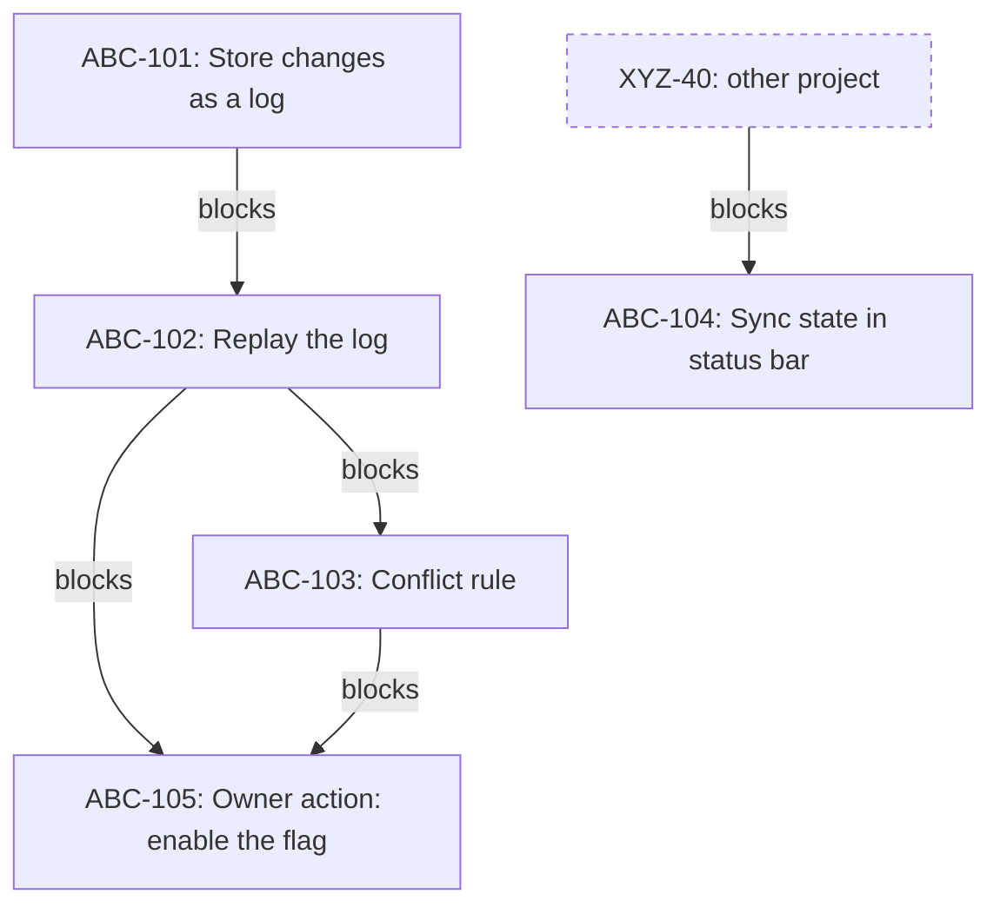

# Analyzing dependencies

Map the blocking links between tickets and say what can start now. Order in this
model comes only from blocking links (see `linear-workflow`), so this map is the plan.
All reads go through [pm-context](../pm-context/SKILL.md); this skill writes nothing.

## Arguments

**Scope** (one required):
- `ticket-key`: the ticket, its sub-issues, and everything linked to them
- `--project NAME`: every open ticket in the project
- `--initiative NAME`: every open ticket in every project of the initiative

**Options:**
- `--depth N`: How many levels of dependencies to trace (default: all)
- `--format`: Output format (text|mermaid|json)
- `--blockers-only`: Only show blocking relationships

## Examples

```
analyzing-dependencies --project "Sync engine"
analyzing-dependencies ABC-456                 # why is this stuck?
analyzing-dependencies --initiative "Version 2" --format mermaid
```

## Workflow

### Step 1: Gather tickets

```python
if key:
    root = pm_context.get_item(key)
    items = [root] + pm_context.get_children(key)
elif project:
    items = pm_context.list_items({project: project})
elif initiative:
    items = pm_context.list_items({initiative: initiative})

# Fetch blockers outside the scope too, so they can be reported as external
for item in list(items):
    for k in item.blocked_by + item.blocks:
        if k not in keys(items):
            items.append(pm_context.get_item(k))  # mark as external
```

### Step 2: Build Dependency Graph

```python
graph = {}
for item in items:
    graph[item.id] = {
        "item": item,
        "blocks": [],      # Items this blocks
        "blocked_by": [],  # Items blocking this
        "parent": item.parent,
        "children": []
    }

# Add dependency edges
for item in items:
    if item.blocked_by:
        for blocker_id in item.blocked_by:
            if blocker_id in graph:
                graph[blocker_id]["blocks"].append(item.id)
                graph[item.id]["blocked_by"].append(blocker_id)
```

### Step 3: Analyze Graph

**Find circular links:**
```python
def find_loops(graph):
    visited = set()
    path = []

    def dfs(node):
        if node in path:
            return path[path.index(node):]  # loop found
        if node in visited:
            return None

        visited.add(node)
        path.append(node)

        for blocked in graph[node]["blocks"]:
            loop = dfs(blocked)
            if loop:
                return loop

        path.pop()
        return None

    loops = []
    for node in graph:
        loop = dfs(node)
        if loop:
            loops.append(loop)
    return loops
```

**Find the longest chain:**
```python
def find_critical_path(graph):
    # Topological sort + longest path
    in_degree = {n: len(graph[n]["blocked_by"]) for n in graph}
    queue = [n for n in graph if in_degree[n] == 0]
    dist = {n: 0 for n in graph}

    while queue:
        node = queue.pop(0)
        for blocked in graph[node]["blocks"]:
            dist[blocked] = max(dist[blocked], dist[node] + 1)
            in_degree[blocked] -= 1
            if in_degree[blocked] == 0:
                queue.append(blocked)

    # Reconstruct path
    max_node = max(dist, key=dist.get)
    return reconstruct_path(graph, max_node, dist)
```

**Find active blockers:**
```python
def find_blockers(graph):
    blockers = []
    for node_id, node in graph.items():
        if node["blocked_by"]:
            for blocker_id in node["blocked_by"]:
                blocker = graph.get(blocker_id)
                if blocker and blocker["item"].status_type != "done":
                    blockers.append({
                        "blocked": node["item"],
                        "blocker": blocker["item"],
                        "status": blocker["item"].status
                    })
    return blockers
```

### Step 4: Generate Report

**Text Format:**
```markdown
## Dependency Analysis: {scope}

### Summary
- Total Items: {count}
- Dependencies: {edge_count}
- Circular: {loop_count}
- Currently Blocked: {blocked_count}

### Longest chain
{item1} → {item2} → {item3} → {item4}
Length: {path_length} items

### Circular Dependencies
⚠️ Circular links: {item1} → {item2} → {item3} → {item1}
   Remove or reverse one link before work starts.

### Active Blockers
{for blocker in blockers:}
🔴 [{blocker.key}] ({blocker.status}) blocks:
   - [{blocked1.key}] {blocked1.title}
   - [{blocked2.key}] {blocked2.title}

### Blockers in other projects
{blocker key, its project, its status, and what it blocks here}

### Ready to start
{open tickets whose blockers are all done}

### Overlaps
{pairs of ready tickets likely to touch the same files: run them in order, not in parallel}

### Dependency Tree
{visual tree representation}
```

**Mermaid Format:**


## Output Examples

```
📊 Dependency analysis: project "Sync engine"

Summary:
  Items: 15
  Dependencies: 8
  Circular: 0 ✅
  Blocked: 3

Longest chain (5 tickets):
  ABC-124 → ABC-126 → ABC-130 → ABC-131 → ABC-132

Active Blockers:
  🔴 [ABC-126] Database Schema (In Progress)
     Blocks: ABC-130, ABC-131

  🔴 [ABC-127] API Setup (Todo)
     Blocks: ABC-129

Ready to start:
  ✅ ABC-124 - No dependencies
  ✅ ABC-125 - No dependencies
  ✅ ABC-128 - No dependencies
```

## Error Cases

| Issue | Action |
|-------|--------|
| Circular links | Report the loop; suggest which link to drop |
| Blocker in another project | Report it with its project and status |
| Linked ticket not found | Warn about the broken link |

## Platform notes

- [platforms/claude-code.md](platforms/claude-code.md)
- [platforms/hermes.md](platforms/hermes.md)
